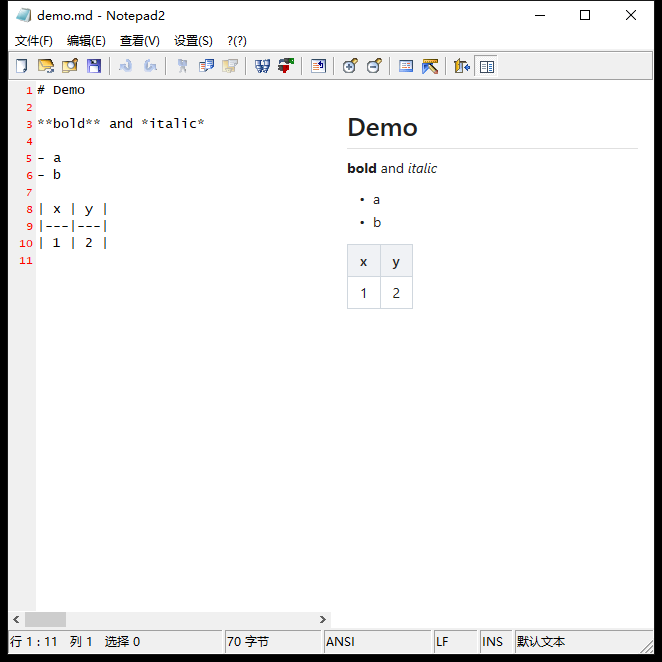

# notepad2md

> 基于 Notepad2 二次开发的 Markdown 编辑器 —— 单文件 exe、实时预览、零运行时依赖。

**项目主页**：<https://github.com/SorenBoot/notepad2md>
**问题反馈**：<https://github.com/SorenBoot/notepad2md/issues>



---

## 这是什么

notepad2md 是 [Notepad2 4.2.25](https://www.flos-freeware.ch/) 的二次开发版本。

Notepad2 是 Florian Balmer 于 2004–2011 年开发的轻量级记事本替代软件，以极小的体积、
完整的语法高亮和快捷操作著称。notepad2md 在**完整保留原版全部编辑能力**的前提下，
加入了 Markdown 实时预览与简体中文界面：

- 基于 Notepad2 4.2.25 + Scintilla 2.24 + md4c
- 新增 Markdown 实时预览窗格（MSHTML 引擎，系统自带，无需安装运行时）
- 新增简体中文界面（与英文界面打包在同一 exe 内，按系统区域自动切换）
- 其他改动均为使其可用 MinGW-w64 编译的最小必要修改，未改动原版功能逻辑

> 本项目遵循 Notepad2 的 BSD 3-Clause 许可证。
> 原始代码版权归 Florian Balmer (2004–2011)，本项目新增部分的版权归 SorenBoot (2025–2026)。
> 详见 [LICENSE](LICENSE) 与 [LICENSE-THIRD-PARTY/](LICENSE-THIRD-PARTY/)。

## 特性

**体积与依赖**

- **单 exe，约 2.9 MB** —— 静态链接 libgcc / libstdc++ / winpthread，拷贝即用
- **零运行时依赖** —— 只依赖 Windows 系统 DLL（Win7 起全部自带）
- 内存占用：空载约 15 MB，开启预览约 40 MB（MSHTML 约占 25 MB）

**Markdown 预览**

- **实时预览** —— 左右分栏，边打边看（`Ctrl+Alt+M` 开关）
- **可拖动分隔条** —— 拖动调整两栏宽度，双击复位 50/50，比例自动记忆
- **增量刷新，不闪屏** —— 首次加载完整文档，之后只更新内容容器，滚动位置保留
- **输入防抖** —— 连续按键合并（约 120 ms），不会每敲一个字都重排
- **GFM 语法** —— 表格、任务列表、删除线、脚注、围栏代码块
- **代码块复制按钮** —— 预览里的围栏代码块带语言标签与「复制」按钮
- **链接外开** —— 预览里的链接用系统浏览器打开，不在窗格内跳转
- **编码自动转换** —— UTF-8 与 GBK 等本地代码页都转成 UTF-8 渲染，中文文件无乱码
- **安全** —— HTML 标签被转义（`NOHTML`），预览不执行脚本

**编辑能力（继承自 Notepad2）**

- Scintilla 语法高亮（完整保留原版全部快捷键）
- 代码折叠、列选择、正则查找替换、编码转换
- 窗口置顶（`Alt+T`）

**界面语言**

- 简体中文与英文两套界面打包在同一 exe 内：
  - 系统区域为中文（中国大陆）→ 显示中文界面
  - 其他区域 → 显示英文界面
- 想在中文系统上强制用英文界面，可用 [Resource Hacker](http://www.angusj.com/resourcehacker/)
  调整资源语言，或把 `src/Notepad2.rc` 里中文块结尾的 `#endif` 注释掉后重新编译

## 系统要求

| 项目 | 要求 |
|---|---|
| 操作系统 | Windows 7 SP1 / 8 / 8.1 / 10 / 11 |
| 架构 | x64（不支持 32 位 Windows） |
| 运行时 | **无** |

MSHTML 预览渲染依赖系统组件，Win7 起均内置。预览引擎为系统自带的 MSHTML（Trident）
而非 WebView2：不额外分发运行时、进程内渲染、内存更省；代价是 CSS 支持止步于 IE11
水平（不支持 CSS 变量 / Grid / `flex gap`）。

## 获取与编译

### 方式一：下载编译好的版本

前往 [Releases](https://github.com/SorenBoot/notepad2md/releases) 页面。

### 方式二：自行编译

需要 **MinGW-w64**，GCC 11 或更高。推荐便携版 [w64devkit](https://github.com/skeeto/w64devkit)
（约 100 MB，解压即用）。

```
build\build.bat          双击即可编译，无需 make
```

或：

```bash
cd build
make                    # Release x64
make DEBUG=1            # Debug
make clean
make run
```

产物输出到 `bin\notepad2md.exe`。

默认工具链路径为 `C:\Tools\W64DEVKIT\w64devkit\w64devkit`，装在别处时：

```bash
# build.bat 里改
set W64DEVKIT=你的路径

# 或 make 时传参
make W64DEVKIT=/d/your/w64devkit
```

## 目录结构

```
notepad2md/
├── build/                构建脚本（Makefile + build.bat）
├── src/                  源码
│   ├── Notepad2.c        主程序
│   ├── Edit.c            编辑区逻辑
│   ├── Dialogs.c         对话框
│   ├── Styles.c          配色方案
│   ├── Dlapi.c           目录/文件列表 API
│   ├── Helpers.c         工具函数
│   ├── Print.cpp         打印
│   ├── Markdown.c        Markdown 解析（新增）
│   └── Preview.c         预览渲染（新增）
├── scintilla/            编辑引擎（仅编译必需文件）
├── md4c/                 Markdown 解析器（MIT）
├── res/                  图标 / 光标 / 位图 / manifest
└── LICENSE-THIRD-PARTY/  第三方许可证
```

> `docs/` 与 `tests/` 在本地开发时使用，未纳入公开仓库。

## 相对原版 Notepad2 的改动

| 文件 | 改动 | 原因 |
|---|---|---|
| 9 个源文件 | `_WIN32_WINNT` 0x0500/0x0501 → 0x0601 | 兼容底线从 XP 提升到 Win7 |
| `src/Edit.c` | `FARPROC` → 显式函数指针类型 + 强转 | GCC 16 的 `FARPROC` 为严格无参类型 |
| `src/Helpers.c` | 同上，另 `GetThemedDialogFont` 内联调用改为类型化 | 同上 |
| `src/Helpers.h` | `Toolbar_SetButtons` 参数 `void*` → `LPCTBBUTTON` | 与实现一致，MSVC 容忍而 GCC 不容忍 |
| `src/Dlapi.c` | COM 接口调用加 `(void**)` / `(const ITEMIDLIST**)` 强转 | MinGW 的 `shlobj.h` 参数类型更严格 |
| `src/Print.cpp` | 补 `max`/`min` 宏 | MinGW 的 `minwindef.h` 不提供 |
| 4 个文件 | ISO-8859 非 ASCII 字符 → ASCII | GCC 默认按 UTF-8 读源码 |
| `src/Notepad2.c` | 新增 `PreviewUpdate` / `PreviewToggle`，`SCN_MODIFIED` 防抖，菜单项与 ini 持久化 | notepad2md 功能接入 |
| `src/Notepad2.rc` / `resource.h` | 新增菜单项、加速键 `Ctrl+Alt+M`、中文资源块 | 功能与中文化 |
| `res/Notepad2.ico` | 换成含 128×128 的多尺寸图标 | 大图标不再模糊 |
| `res/Toolbar.bmp` | 23 → 24 个图标 | 新增分栏预览图标 |
| `build/Makefile` | windres 规则补 `res/` 依赖 | 详见下方"两个坑" |

### 两个 MinGW 特有的坑（已修）

1. **工具栏完全看不见** —— MinGW 的 `commctrl.h` 在 `NTDDI_VERSION >= 0x06000000` 时给
   `REBARBANDINFO` 追加字段，`sizeof` 变成 128 字节，而系统 comctl32 只认 112 字节布局，
   `RB_INSERTBAND` **静默失败**。修法：向 rebar 报告传统布局大小。
2. **改了图标不生效** —— windres 规则原先只依赖 `.rc` 与 `resource.h`，改 `res/` 下的图标
   只重新链接而不重新编译资源。已把 `res/` 下所有文件列为依赖。

> 用 `-DPREVIEW_DEBUG` / `-DBAR_DEBUG` 做过调试构建后，请先 `make clean` 再构建发布版，
> 否则调试版的 `.o` 会被复用。

## 许可证

本项目沿用上游 Notepad2 的 **BSD 3-Clause** 许可证（见 [LICENSE](LICENSE)）：

- 原始 Notepad2 代码：Copyright (c) 2004-2011 **Florian Balmer**
- 本项目新增代码：Copyright (c) 2025-2026 **SorenBoot**

第三方组件许可证见 [LICENSE-THIRD-PARTY/](LICENSE-THIRD-PARTY/)：

- Notepad2 —— BSD 3-Clause
- Scintilla —— 类 BSD（[License](LICENSE-THIRD-PARTY/Scintilla-License.txt)）
- md4c —— MIT（[License](LICENSE-THIRD-PARTY/md4c-License.md)）

## 致谢

- [Florian Balmer](https://www.flos-freeware.ch/) —— Notepad2 原作者
- [Neil Hodgson](https://www.scintilla.org/) —— Scintilla
- [Martin Mitas](https://github.com/mity) —— md4c

---

*notepad2md 是非官方的二次开发项目，与 Notepad2 原作者无关联。*
